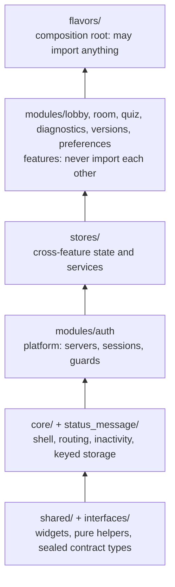

# ADR-005: Module Layering and Cross-Feature State

- **Status:** Accepted (2026-10-16)
- **Date:** 2026-10-13
- **Authors:** William Karol Di Cioccio
- **Supersedes:** —
- **Superseded by:** —
- **Amends:** decisions 5–7 of `docs/plans/0001-app-shell/proposal.md`
  (interfaces, co-located providers, composition over configuration)

---

## 1. Context and Problem Statement

`CLAUDE.md` describes `core` as the shell modules plug into, and says modules
are "included/excluded by presence in the flavor". Neither holds. An import
scan of `lib/src` (October 2026, tracked in #607) finds the following.

**`core` imports feature modules.** That makes a cycle, since every module
imports `core`.

| Edge | Count | Through |
| ---- | ----- | ------- |
| core → auth | 8 | `core/inactivity/inactivity_monitor.dart`, `inactivity_provider.dart` (`ServerManager`, `ServerEntry`, auth tokens, the logout-flag storage, two providers); `core/removed_server_cleanup.dart` (`ServerManager.onServerRemoved`, `ReturnToStorage`) |
| core → lobby | 1 | `removed_server_cleanup.dart` → `lobby_read_markers.dart` |
| core → room | 4 | `removed_server_cleanup.dart` → `database_selections`, `document_selections`, `thread_anchor_storage`, `thread_read_markers` |

**Feature modules import each other.**

| Edge | Count | What is used |
| ---- | ----- | ------------ |
| lobby → room | 5 | `RunRegistry`, `room_run_activity`, `ThreadAnchorStorage`, `ThreadReadMarkerStorage` |
| room → lobby | 4 | `RoomReadMarkers`, `ServerReadMarkers`, `UnreadDot` (a 26-line widget) |
| room → diagnostics | 2 | `JsonTreeModel`, `JsonTreeView` (in `dropped_event_message_tile.dart`) |

**Every feature module imports auth**, and auth imports none of them:

- room 22 imports;
- lobby 13;
- versions 8;
- quiz 4;
- diagnostics 1.

What they use is `ServerManager`, `ServerEntry`, `AuthSession`,
`requireConnectedServer` and the `HomeShell` scaffold. `lib/src/interfaces/`
holds only the sealed `AuthState`, which only auth and the standard kit
import.

The consequences:

- **Modules cannot be dropped.** Lobby and room cannot be omitted from a
  flavor: each module's constructor takes the other's types, and
  `docs/authoring-a-flavor.md` already tells forks "do not drop standard
  ones". Only versions is cleanly omittable.
- **Cleanup is centralised in core.** `RemovedServerCleanup` lives in
  `core` but is constructed and owned by `RoomAppModule`. It clears lobby's
  and room's stores. Every module that persists per-server state must be
  added to that one class by hand. `d6085bec` made its trigger an explicit
  event, and left it importing concrete module types.
- **Nothing holds the line.** No lint, test or `custom_lint` rule checks
  import direction; `analysis_options.yaml` includes only `flutter_lints`. The
  edges grew because nothing stopped them.

## 2. Decision

Adopt an explicit layer order. A unit may import only units **below** it,
plus itself.

The arrows point upward: each layer may be imported by the layers above it.
`lib/src/mockups` sits outside the order. It may import anything, and nothing
may import it.

Five moves bring the code to that shape:

1. **Name auth as the platform layer.** Features depend on servers and
   sessions, and that dependency is the product, not drift. No wrapper
   interfaces are introduced for `ServerManager` or `ServerEntry`; #23
   (splitting `ServerManager`) is where that surface gets smaller.
2. **Create `lib/src/stores/` for state more than one feature reads.** Move
   into it:
   - `lobby/lobby_read_markers.dart`;
   - from room: `run_registry`, `room_run_activity`, `thread_anchor_storage`,
     `thread_read_markers`, `document_selections` and `database_selections`.

   Move `UnreadDot` and the diagnostics JSON tree to `shared/`. These are
   moves, not rewrites.
3. **Move server-removal cleanup out of core and give it a proper owner.**
   - `RemovedServerCleanup` moves to `stores/`, which may import auth's
     `ReturnToStorage`.
   - It is constructed and disposed by a route-less `StoresAppModule`
     (namespace `stores`) that the composition kit registers before the
     features. That module also owns the shared stores it hands to them.
   - The "cleared everything on removal" guarantee stays in one class, and
     no lifecycle hook is added to `AppModule`. The original plan's "no
     module lifecycle hooks" non-goal therefore stands.
   - `AppModule` already allows a module with overrides and no routes
     (`DocumentBrowserUrlModule`).
4. **Invert the inactivity dependency.** `core/inactivity` defines the small
   interface it needs: the active sessions as a signal, "log out all", and
   "mark this server inactive". It reads that interface through a provider
   that defaults to null. The auth module supplies the implementation as an
   override. That matches today's behaviour, since the provider already
   tolerates auth being absent.
5. **Enforce it.** Add `test/architecture/import_boundaries_test.dart`. It is
   modelled on `test/design_system_hygiene_test.dart`, scans `lib/src`, and
   fails on any import that goes against the layer order. It ships first,
   with a baseline allowlist of today's violations. Each move removes entries
   from the baseline, and a new violation fails CI immediately.

## 3. The Decisions, by Axis

### 3.1 Why auth is a layer and not a module like the others

All five feature modules import auth, and auth imports none of them. Putting
per-use interfaces in front of 48 imports would add ceremony without
decoupling anything: a feature cannot run without a server and a session. A
named layer states the truth and keeps the rule simple: features never import
features.

### 3.2 Why move state down instead of adding hooks

Lobby and room do not call each other. They read the same state: unread
markers, which runs are active, where a thread was left. That state has no
natural owner among the features, so it gets its own layer. Hooks (each
module registers its own cleanup with core) were considered. They would fix
`core → modules` but not `lobby ↔ room`. They would also reverse the "no
lifecycle hooks" non-goal, and scatter the removal guarantee across modules
so that nothing owns "did we clear everything".

### 3.3 Why a baseline-first test

The moves touch about 25–30 files in `lib` and a similar number of tests, and
will land in several PRs. A test that fails on new edges from day one stops
the drift while the cleanup is in progress. The baseline list doubles as the
progress tracker for #607.

## 4. Consequences

**Positive**

- `core` imports nothing from `modules/`, and no feature imports another.
  These are #607's acceptance criteria.
- Shared state has an obvious home. A new store that must be cleared on server
  removal lives next to the class that clears it.
- Quiz, diagnostics and versions become omittable at compile time. Lobby and
  room become omittable at compile time once neither takes the other's types.

**Negative / cost**

- Import churn across `lib` and `test`; the moves are mechanical but wide.
  They should not land during #601, the `_RoomScreenState` split, in the same
  files.
- `stores/` can become a dumping ground. The rule is to move a type there
  only when a second feature reads it.
- `run_registry.dart` carries room behaviour (auto-filed failure feedback). It
  moves as a unit now; whether that behaviour belongs elsewhere is a separate
  question.

**Enforcement.** `test/architecture/import_boundaries_test.dart`, run in the
existing CI test job.

## 5. Known Limitations and Open Questions

1. **Omittable at compile time is not omittable at run time.** Modules
   navigate to each other's routes by constant. For example, auth's
   `requireConnectedServer` redirects to `AppRoutes.lobby`, and room pushes
   `AppRoutes.quiz` and `AppRoutes.diagnostics`. Dropping a module leaves
   links to an unknown route. A boot-time check of route references, or
   optional navigation, is a follow-up (see ADR-004 §5).
2. **Interaction with #23.** Splitting `ServerManager` changes the auth
   layer's surface, including `onServerRemoved`, which cleanup subscribes
   to. Land this ADR's moves first, or agree the split's shape before moving
   `RemovedServerCleanup`.
3. **`HomeShell` stays in `auth/ui`.** Features may import auth, so this is
   legal. If a flavor ever needs a shell without auth, it moves to `core/ui`.
4. **Packages as boundaries.** Per-module Dart packages would make the
   compiler enforce layering. That is deferred until the library's public
   API policy is decided.

## 6. Migration

In order, each step a separate PR that shrinks the baseline:

1. Add the boundary test, with today's violations as its baseline.
2. Move `UnreadDot` and the JSON tree to `shared/`. This removes
   room → lobby (UI) and room → diagnostics.
3. Create `stores/` and move the shared stores and `RemovedServerCleanup`
   into it. Add `StoresAppModule` to the standard kit. This removes
   lobby ↔ room and core → lobby/room.
4. Add the inactivity interface and the auth override. This removes
   core → auth.
5. Delete the now-empty baseline, update `CLAUDE.md` and
   `docs/authoring-a-flavor.md`, and close #607.

## 7. Alternatives Considered

| Alternative | Why rejected |
| ----------- | ------------ |
| Hooks: modules register per-server cleanup and inactivity callbacks with core via `AppModule` | Fixes core → modules but not lobby ↔ room; reverses the "no lifecycle hooks" non-goal; scatters the removal guarantee. Kept only for inactivity, as a provider-level interface rather than an `AppModule` hook. |
| Accept the coupling, document allowed edges, enforce only "no new edges" | Cheap, and its test is step 1 of this ADR. On its own it leaves the cycles and the "do not drop standard modules" rule in place, and does not close #607. |
| Interfaces in `lib/src/interfaces/` for every cross-module use | Most cross-module use is shared state, not behaviour; interfaces over state add indirection without removing the shared owner problem. |
| One Dart package per module | Compiler-enforced, but forces a public API per module before the library's compatibility policy exists. |
| `custom_lint` or `import_lint` rules | A plugin dependency for a rule a 40-line test can enforce; can be revisited if more architectural lints accumulate. |
