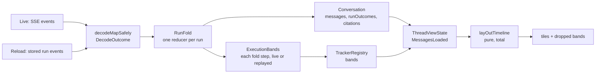

# ADR-006: The Thread Timeline Model — Runs, RunFold, Bands and One Layout

- **Status:** Accepted (retroactive record of #223, #566, #578 and #617–#619)
- **Date:** 2026-10-13
- **Authors:** William Karol Di Cioccio
- **Supersedes:** —
- **Superseded by:** —

---

## 1. Context and Problem Statement

A thread's timeline is the core of the product: what the user asked, what
each agent run said and did, and how each run ended. It is also the most
rewritten part of the app:

- `ui/room_screen.dart` has more than 200 commits;
- `thread_view_state.dart` and `run_orchestrator.dart` have more than 60 each.

The same rules kept being written in several places, and the copies drifted.
Before #566, where a run's work rendered was "decided today in four places
that have to agree: the display filter, the no-response synthesis gate, the
tracker re-keying, and the bucketing rules in historical replay. Nothing
checks the property all four exist to hold, which is why a band could render
nowhere and a full suite stay green" (`cc1fb454`).

Before #619, the live stream and a reopened thread folded events through two
copies of the same logic. They drifted too: `8a7fccd5` found that
`replayToTrackers` "re-derived it … That copy of the history replay's rule
had drifted".

The model has now converged. This ADR records it, so that the
`_RoomScreenState` split (#601) and later work change it deliberately rather
than rediscover it.

## 2. Decision

1. **One reducer per run.** `RunFold`
   (`packages/soliplex_client/lib/src/application/run_fold.dart`) folds one
   AG-UI run into the `Conversation`, event by event. `RunOrchestrator`
   (live) and `replayThreadHistory` (reload) both go through it, "so a run
   reads the same either way".
2. **A terminal run parks an outcome, and that is the only record of how it
   ended.**
   - Every terminal run adds a `NoResponseTile` to
     `Conversation.runOutcomes`, keyed by run id and in the order runs ended
     (`run_ending.dart`, `conversation.dart`).
   - Parking is unconditional. Whether the outcome shows is decided by the
     timeline, "where the whole timeline is visible" (`7e84ce07`).
   - A run that yields to a client tool has not ended, and its outcome is
     withdrawn.
3. **Bands belong to the reply that spoke for them.**
   - A band is an `ExecutionTracker` holding a response's work.
   - Before any message speaks for it, it is keyed by
     `noResponseMessageId(runId)`, the same id as the run's parked outcome.
   - Once a reply speaks, the band is handed to it (#578).
   - Bands are built only by `TrackerRegistry`, fed on both paths by
     `ExecutionBands` (`lib/src/modules/room/execution_bands.dart`) through a
     `RunFoldObserver`: each run starting, each event folded, and how each
     run ended. Live, `RunOrchestrator` reports them as it folds the stream
     (`AgentSession.observeRunFold`); on reload, history replay as it folds
     the stored events. For the same events both report the same calls in
     the same order (except a client-tool wait that ended without resuming
     the turn, which only live sees), so the order a registry is fed in, how
     a run's end settles its band, and ignoring what a run folds after its
     terminal event are each written once, in `ExecutionBands`.
   - What differs is the source of the steps, the clock, and when an ending
     is told. A live band times its steps by a running clock, a reloaded one
     by the stored events' times. Live knows at once that a run waits on a
     client tool; replay holds each run's ending until the next run whose
     events were read starts and says whether it continues the turn, or the
     history ends.
   - A client tool's call has one step, from the model's `TOOL_CALL_START`.
     Running the tool adds none; its card shows how it went.
4. **Where things render is decided once, by a pure function.**
   `layOutTimeline` (`lib/src/modules/room/lay_out_timeline.dart`) takes the
   committed messages, the bands, the parked outcomes and the active run's
   streaming state, and returns tiles plus the bands it could not place. It
   holds one invariant:

   > every terminal run with a parked outcome has a band-capable assistant
   > tile, and every band attaches exactly once to a band-capable tile of the
   > run that produced it.

   It runs in four steps: Project (merge streaming), Filter (drop messages
   that exist only as a tool call's parent), Guarantee (give a run with no
   band-capable tile its outcome), and Place (attach bands).
5. **A band that cannot be placed is dropped and reported, never moved.**
   "A band rendering somewhere wrong is worse than a band reported missing"
   (`cc1fb454`). Dropped bands are logged once at warning. A drop means an
   invariant broke, and is a defect.
6. **Failures are data in the timeline, not exceptions at render.**
   - Each of these becomes a `DroppedEventMessage` (a drop tile) at the
     failure's position: an event that fails to decode, a `processEvent`
     throw, and a run whose events could not be fetched.
   - Drop-tile ids are derived from the run id and event index, so reload
     reproduces the live thread (#223).
   - A failed run whose reply survives shows its outcome beside the reply
     (`eb839986`). `ErrorMessage` is only for a `RUN_ERROR` before the run
     began.
7. **History is authoritative only for the runs it read, and only once it
   read the turn's last run.**
   - On return to a thread, the view restores what the registry holds, then
     always fetches.
   - For each run the fetch read, history wins. The view keeps its own copy
     of runs history has not stored yet (`setAside`).
   - A turn is taken from history only once the fetch read the turn's last
     run. A run that waited on a client tool, read without the run that
     resumed it, would otherwise end the turn early (`0f67979b`).
   - History reads no run the backend has not finished. It reports the
     thread's newest run, if still going, sent a message, and not resuming a
     turn the thread already holds (§5, item 5), as
     `ThreadHistory.runInProgress`, and the view follows it as a live run
     (`AgentRuntime.follow`): the same fold, states, tile and registry entry,
     from the run's first stored event. It is not followed while a session
     holds the thread, nor once the view holds how it ended: a run stopped
     here goes on until the backend finishes it.
8. **Runs outlive views.** `RunRegistry` holds sessions by `ThreadKey` and
   captures terminal outcomes, "because a view unmounts. A run that fails
   after the user navigates away must still be recorded". Only the cancel
   button cancels; navigation only stops observing
   (`docs/send-cancel-lifecycle.md`).
9. **Citations belong to the turn.**
   - A turn is the user message plus every run it spans.
   - `MessageState` is keyed by user message id, and `RunFold` accumulates
     `turnCitations` across a turn's runs. A resumed run's figures therefore
     survive a later `searches` clear.
   - Citations show on the turn's last assistant text message. This is a
     backend and client data limitation (`docs/plans/citations-ui/plan.md`).

## 3. Rules for Changing the Timeline

These follow from §2. They are what a reviewer should check.

- **No placement logic outside `layOutTimeline`.** A filter, gate or
  re-keying added elsewhere recreates the four-places problem. Change the
  function and its matrix instead.
- **Every new `ChatMessage` variant must be classified.**
  `_standsInForItsRun` is an exhaustive switch, so a new variant is a compile
  error until someone decides whether it can host a band.
- **Every change to how events become conversation goes through `RunFold`.**
  A rule implemented on only one path breaks parity. The parity suites fail
  on it, and only for the cases they cover.
- **Ids that must agree come from one function.** `noResponseMessageId` keys
  both a run's outcome tile and its unclaimed band. Drop-tile ids are derived
  from the run id and event index.
- **The model never substitutes a client clock.** Undated rows take the run's
  last timed event (`RunFold.undatedRowTime`).
- **A view may watch a run but never ends it.** Cancelling is the user's
  action alone.

## 4. Consequences

**Positive**

- The question "where does this run's work render" has one answer in one
  place, and a property test that fails when it is wrong.
- A thread reads the same live and after reload. That is checked event by
  event, not hoped for.
- Malformed events and failed fetches degrade one row, not the run or the
  thread.

**Negative / cost**

- `ThreadViewState`'s merge of restored and fetched runs is the densest logic
  in the room module. It is the main hazard for #601.
- `layOutTimeline` is called from three sites in the room module
  (`ui/message_timeline.dart`, `ui/room_screen.dart`, `unread_boundary.dart`)
  and from the mockup harness's drifted copy of the room screen
  (`lib/src/mockups/chat/chat_screen.dart`). They must pass the same inputs,
  or the unread boundary and the rendered timeline disagree.
- The vocabulary is precise and has changed several times (§7). Code and
  reviews must use the current terms.

**Enforcement**

| Rule | Pinned by |
| ---- | --------- |
| The layout invariant, over the full case matrix | `test/modules/room/lay_out_timeline_matrix_test.dart` ("no band renders nowhere", "every band renders on a tile of its own run", "no tile renders two bands", "every run that ended reaches a tile") |
| Drop over misplace | `test/modules/room/lay_out_timeline_test.dart` |
| Live and reload agree on messages, states, outcomes and bands | `test/modules/room/replay_parity_test.dart` |
| Live and reload produce the same layout, after every event | `test/modules/room/live_reload_parity_test.dart` |
| History taken only once the turn's last run was read | `test/modules/room/thread_return_test.dart`, `thread_view_state_test.dart` |
| A followed run ends as the live run of the same events | `packages/soliplex_agent/test/orchestration/follow_run_test.dart` |
| A run still going is followed once, and not after a stop | `test/modules/room/thread_view_state_test.dart` ("a run still going on the backend") |

## 5. Known Limitations and Open Questions

From #619's "Not in this PR" and #566's known issues:

1. **There is no single turn model for live and reload yet.** Still open:
   - placement around a resumed client-tool run;
   - merging history with a live client-tool session;
   - seeding the session cache from a late history.

   Client-tool support is best effort and not used in production.
2. **Remaining display gaps.**
   - A row created before any timed event is undated live but dated on
     reload.
3. **Unhosted combinations.** A system-role reply cannot host a band. The
   `GenUiMessage` combination is "unsupported rather than intended".
   Changing either touches `layOutTimeline`, `TrackerRegistry` and the tile
   together.
4. **Backend assumptions.**
   - Drop-tile ids match across paths only because the backend stores one
     event per streamed event. That assumption is unpinned.
   - The backend keeps no run status, which is why the registry files
     failures as feedback.
   - A run the backend lost (it restarted mid-run) is never marked finished,
     and its stored stream sends keepalives forever. A followed run therefore
     ends as cut off after 10 minutes without an event (`defaultHttpTimeout`).
     A live run that resumes after a dropped connection reads the same stream
     and has no such bound.
   - An unfinished run that is not the thread's newest is taken to be lost: it
     is neither shown nor followed.
5. **Following a client-tool turn.**
   - A followed run that waits on a client tool has the follower run the tool
     and resume the turn, as live does. A run followed in two places at once
     would be resumed twice.
   - A run already resuming a turn when the thread loads (its message repeats
     the run before it) is not followed: that needs the turn resumed first, as
     live resumes it, which is the turn model of item 1.
6. **Mutation-testing survivors.** #566 listed survivors (the whitespace
   guard, the active-run guard, a dead known-run entry). It is not recorded
   whether later work closed them.

## 6. Alternatives Considered

What was tried, and why it was replaced:

| Approach | Replaced by | Why |
| -------- | ----------- | ----- |
| Placement decided in four places (display filter, synthesis gate, tracker re-keying, replay bucketing) | `layOutTimeline` (#566) | Nothing checked the shared property; bands rendered nowhere with a green suite |
| A synthesis gate that appended a "no response" tile when it guessed a run had nothing to show | Unconditional parking (`7e84ce07`) | The gate guessed without seeing the timeline; parking lets the timeline decide |
| `TextMessage` overloaded with `terminalReason` flags | The sealed `NoResponseTile` (`c6ed6d59`) | Mixed display state into a wire type and leaked it |
| Per-tile `try/catch` around rendering | Drop tiles at the data layer (`0fabfb60`, #223) | It caught nothing that `build()` throws and "gave false confidence" |
| Separate fold logic for live and replay, and replay inside `SoliplexApi` | `RunFold` on both paths (#619) | The copies drifted |
| Bands subscribing themselves | Routing only through `TrackerRegistry` (`79febc27`) | Production never used the self-subscription; tests did |
| Reload bands bucketed by `replayToTrackers` against the replayed messages | Reload feeding a `TrackerRegistry`, the one live uses, from replay's fold | A second copy of the speaking rule, the band endings and the activities, which drifted from live |
| A run-keyed band held until the response ended | Handing the band to the reply as soon as it speaks (#578) | The band sat on the loading tile |
| Restore from the registry and skip the fetch | Restore, then always fetch, history authoritative per run (#578) | The fetch was skipped for turns the backend had not stored yet |
| A red `ErrorMessage` under a surviving reply | The outcome beside the reply (`eb839986`) | It looked like a fresh error on every reload |

## 7. Glossary

| Term | Meaning |
| ---- | ------- |
| **Run** | One AG-UI run, folded by `RunFold`. |
| **Turn** | A user message plus every run it spans; a client-tool resume adds runs. |
| **Parked outcome** | `Conversation.runOutcomes[runId]`, a `NoResponseTile`; the only record of how a run ended. |
| **Band** | An `ExecutionTracker`: a response's work, rendered under a tile. |
| **Claimed / unclaimed band** | Keyed by the message that spoke for it, or by `noResponseMessageId(runId)` before one does. "Claim" means only a band being taken. |
| **Tile** | A `RenderedTile` (message, band, `besideReply`). |
| **Band-capable** | A tile that may host a band: an assistant text message, a `NoResponseTile`, or a loading tile, provided it is not `besideReply`. |
| **besideReply** | A failed run's outcome shown after its surviving reply; hosts no band. |
| **Drop tile** | `DroppedEventMessage`: a failure recorded at its position in the run. |
| **Dropped band** | A band `layOutTimeline` could place nowhere; a defect, logged once. |
| **setAside** | Runs history read while the view keeps its own copy. |

Retired terms: "orphan" (now "superseded" or "standalone"), "synthesis" and
the no-response synthesis gate, `runErrorMessageId`, `seedHistorical`, and
`no_response_synthesis.dart` (now `run_ending.dart`).
