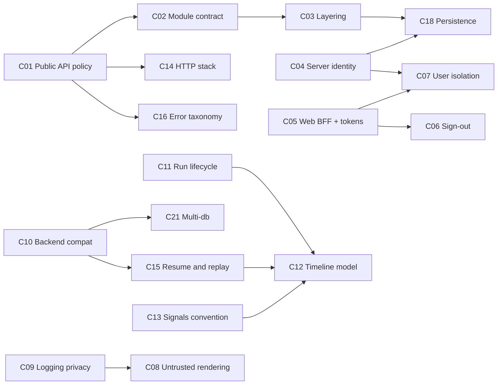

# ADR candidates

As of 2026-10-09, `main` @ `67b846e3`. This document lists the surfaces,
structures, seams and contracts in this repo that deserve an Architecture
Decision Record. It builds on [`architecture-overview.md`](architecture-overview.md)
and is the second step of the "Project Management 101" plan.

**How it was produced.** Five read-only Sonnet agents worked in parallel:
recorded-decision inventory, shell and library contract, auth and security,
agent/client/wire contract, and git/PR history (1,648 commits, about 300 PRs
and issues). The load-bearing claims were spot-checked against code before
writing. Items marked *(unverified)* were reported but not confirmed.

## How to read this

Each candidate has a **kind**:

| Kind | Meaning | Work needed |
| ---- | ------- | ----------- |
| **Retro** | The decision is made and shipped; its reasoning lives only in code comments, commit bodies or one person's head. | Write it down: context, decision, alternatives, consequences. Cheap. |
| **Open** | The code embodies a choice nobody has explicitly made, or there is a live tension (open issue, known gap, contradiction). | A decision meeting first, then the ADR. |
| **Amend** | An existing ADR or doc covers part of it and is stale or too broad. | Edit or split the existing record. |

**Priority.**

- **P1:** a wrong or unrecorded call here constrains forks, deployers, IdP
  operators or the backend team, or has security impact.
- **P2:** a contributor convention that is costly to reverse.
- **P3:** useful to pin down, but low reversal cost.

"Who is bound" names whoever has to know about the decision outside this
repo's maintainers.

## Ranked summary

| # | Candidate | Kind | Pri | Who is bound |
| -- | --------- | ---- | --- | ------------ |
| C01 | Library public API and compatibility policy | Open | P1 | Forks |
| C02 | Module composition contract — **done: ADR-004 (#620)** | Retro | P1 | Forks |
| C03 | Module layering and inter-module contracts — **proposed: ADR-005 (#620)** | Open | P1 | Forks, contributors |
| C04 | Server identity, alias and URL scheme | Open | P1 | Users (links), forks |
| C05 | Web sign-in via backend BFF and token custody on web | Open | P1 | Backend, deployers |
| C06 | Sign-out and IdP session end | Retro + Open | P1 | Backend, IdP operators |
| C07 | User identity and in-memory isolation | Open | P1 | IdP operators |
| C08 | Rendering untrusted model output | Open | P1 | Users, deployers |
| C09 | Logging privacy and diagnostics exposure | Amend + Open | P1 | Contributors, forks |
| C10 | Backend compatibility contract | Open | P1 | Backend team |
| C11 | Run lifecycle and failure reporting | Amend + Open | P1 | Backend team |
| C12 | Timeline, runs and bands model — **done: ADR-006 (#620)** | Retro | P1 | Contributors |
| C13 | Signals convention and the 7.x migration | Open | P1 | Contributors, forks |
| C14 | HTTP client stack and token refresh | Retro | P2 | Forks |
| C15 | Stream resume, history replay and failures-as-data | Retro | P2 | Backend team |
| C16 | Error taxonomy as a UI contract | Retro | P2 | Forks |
| C17 | Client-side tools, approval and host APIs | Open | P2 | Forks |
| C18 | Device-local persistence scheme | Retro | P2 | Contributors |
| C19 | Platform split conventions | Retro | P2 | Contributors |
| C20 | OIDC deployment requirements | Retro | P2 | IdP operators |
| C21 | Multi-database thread semantics | Retro | P2 | Backend team |
| C22 | Inactivity logout policy | Open | P3 | Deployers |
| C23 | Time handling | Retro | P3 | Contributors |
| C24 | Product constraints that bind engineering | Retro | P3 | Contributors |
| C25 | Design package boundary and token governance | Amend | P3 | Forks |
| C26 | Boot validation and theme requirements — **partly covered by ADR-004 §3.7** | Amend | P3 | Forks |

## Dependencies between candidates

Deciding some of these first makes others easier or changes their answer.

## Housekeeping on existing records

> **Done in #608**, except splitting ADR-001, which was deferred: its axes
> are numbered, so it can be split when one of them changes.

Do these before writing new ADRs. They are small and they set the template.

- **ADR-003 is `Proposed` but shipped.** `Flavor` and `FlavorTheme` are in
  `lib/src/core/flavor.dart`. Mark it `Accepted`. Its §2 blockquote about
  `runSoliplexShell` taking a builder was patched in place, so record it as
  an amendment instead.
- **ADR-001 bundles six decisions.** These include the `ThreadKey` record,
  ownership-based discovery and runtime-owned disposal. The repo-wide rule
  "Riverpod is DI only, signals for state" sits in §5.3 as a rejected
  alternative. Lift that rule into its own record, or into C13.
- **`docs/plans/0001-app-shell/proposal.md` is stale.** It says modules use "no
  base class or registry", but `AppModule` replaced `ModuleContribution` in
  `da882974`. Add a superseded note.
- **`docs/developer-setup.md` is stale.** It still describes `ag_ui` as a git
  dependency with Git LFS. `pubspec.lock` shows the hosted pub.dev `0.3.0`.
- **`docs/adr/` has no index.** Add a `README.md` with the template, the
  status vocabulary (`Proposed`, `Accepted`, `Superseded`, `Deprecated`)
  and a table of ADRs. `AGENTS.md`'s "Key Documentation" lists neither ADRs
  nor `diagnostics-known-risks.md`.
- **Template.** Keep the existing numbered shape:
  - header bullets: Status, Date, Authors, Supersedes, Superseded by,
    Amends;
  - §1 Context;
  - §2 Decision;
  - §3 Decisions by axis;
  - Consequences;
  - Alternatives (as a table).

  Retro ADRs can drop Migration.

## A. Shell and library contract

### C01 Library public API and compatibility policy (Open, P1)

- **Today.**
  - `lib/soliplex_frontend.dart` exports a curated surface: `AppModule`,
    `ModuleRoutes`, `Flavor`, `ShellConfig`, `buildRouter`, `standard`,
    `standardFlavor`, `ServerManager`, `AuthState`, and a `show`-listed subset
    of go_router, design and logging.
  - Two tests guard it: `test/barrel_module_authoring_test.dart` and
    `test/barrel_reexport_test.dart`.
  - All packages are `publish_to: none`. The app is `0.107.0+93`, and
    `soliplex_client` is `1.0.0-dev`.
  - `soliplex_agent` re-exports most of `soliplex_client`, and the client
    re-exports `ag_ui` (pre-1.0) wholesale. Forks therefore inherit a
    third-party wire type as public API.
- **Why.** Forks build on this surface (CLAUDE.md: "runnable app and
  importable library"). There is no statement of what is stable, how
  breaking changes are versioned, or whether forks may import the packages
  directly. The CHANGELOG already carries "Library consumers (breaking)"
  bullets for agent types the barrel does not export.
- **Decide.**
  - Is the barrel the only stable surface?
  - Is the library version separate from the app's build number?
  - Should the internal DI providers that leak out today
    (`serverManagerProvider`, `inactivityLogoutFlagsProvider`) be exported?
  - Should `ag_ui` sit behind an anti-corruption layer?
  - Which packages do forks consume?

### C02 Module composition contract (Retro, P1)

- **Today.**
  - `ShellConfig.fromModules` (`lib/src/core/shell_config.dart`) validates
    namespaces, routes and public paths. It builds modules in registration
    order and disposes them in reverse. On abort it tears down every module.
  - `ShellConfig.redirect` admits declared public paths first. Module
    redirects then run in order, and the first non-null result wins.
  - `publicPaths` must belong to the declaring module's own routes
    (`router.dart`, `validateModulePublicPaths`).
  - The embedder owns `dispose`.
- **Why.** This is the extension contract for every fork module. Two things
  are security-relevant behaviour: the redirect order, which is implied by
  the order modules are registered, and the rule that public paths belong to
  their module. A hand-built router silently drops an in-flight sign-in
  (comment in `auth_module.dart`). Origin: `da882974`, ADR-003.

### C03 Module layering and inter-module contracts (Open, P1)

- **Today.**
  - `core/` imports auth, lobby and room storage
    (`removed_server_cleanup.dart`, `inactivity/*`). `lobby` and `room`
    import each other.
  - `lib/src/interfaces/` holds only the sealed `AuthState`. Everything else
    crosses modules by concrete import or constructor injection.
- **Why.** CLAUDE.md says modules are "included/excluded by presence".
  Today a fork cannot drop `lobby` or `room`. Root cause:
  `d6085bec` moved cleanup into core.
- **Decide.**
  - The layering rule.
  - Whether `interfaces/` becomes the real contract layer.
  - How per-server cleanup is registered.
  - How the rule is enforced in CI.
- **Tracked in** [#607](https://github.com/soliplex/frontend/issues/607);
  related to #23 (split `ServerManager`).

### C04 Server identity, alias and URL scheme (Open, P1)

- **Today.**
  - `serverIdFromUrl(url) => url.origin`
    (`lib/src/modules/auth/server_entry.dart:10`) is the storage and session
    key.
  - `aliasFromUrl` replaces dots in the host with dashes, appends `-port`,
    and adds `-2`, `-3` and so on when an alias collides. It is persisted and
    used in paths (`/room/:serverAlias/:roomId/...`).
  - Lobby uses `?server=<serverId>`, so one server has two identifiers.
- **Why.**
  - Web URLs and bookmarks are user-facing.
  - The alias is lossy: `http` and `https` on one host collide, and
    collision suffixes depend on the order servers were added. A shared link
    can therefore open a different server on another device.
  - Same-origin backends on different paths cannot coexist.
  - The direction toward shared databases builds on this model.
- **Decide.**
  - A stable identifier in the path, versus the alias.
  - Whether one origin can hold several servers or accounts.
  - What happens to bookmarks when a server is renamed.

### C18 Device-local persistence scheme (Retro, P2)

- **Today.**
  - `core/keyed_storage.dart` builds percent-encoded composite keys with
    `serverId` first, and uses an `unauthenticated` bucket.
  - `core/storage_migration.dart` keeps a single monotonic schema version
    (1) and runs best-effort.
  - Tokens are in `flutter_secure_storage`; everything else is in
    `SharedPreferences`.
  - Read markers are swept by key prefix.
- **Why.** The keys are on-disk user data, so changing them needs a
  migration. Every new store must follow the convention and register for
  cleanup on server removal. Today that registration is a hard-coded list in
  core (C03).

### C19 Platform split conventions (Retro, P2)

- **Today.** Three mechanisms coexist:
  - conditional imports, mostly on `dart.library.js_interop`, with a few on
    `dart.library.io`;
  - `kIsWeb` branches;
  - the injected `PlatformConstraints`.
- **Why.** Contributors need a rule for which mechanism to use. Some failures
  only show at runtime on web: `Isolate.run` compiles but throws, and
  `Platform.*` throws.

## B. Identity, auth and security

### C05 Web sign-in via backend BFF and token custody on web (Open, P1)

- **Today.** Web signs in through the backend (`/api/login/{provider}`, a
  full-page redirect); native uses `flutter_appauth`. Sessions persist through
  `SecureServerStorage` on every platform.
- **Why.** It binds the backend to the login contract, and the web and native
  flows rest on two different trust models.
- **Decide.** The token-custody posture on web. Security specifics are tracked privately until fixed; ask the maintainers.

### C06 Sign-out and IdP session end (Retro + Open, P1)

- **Today.**
  - Signing out of or removing any server with a session triggers
    RP-initiated logout at the IdP (`server_logout.dart`; `ed513e41`,
    `50112f68`).
  - **Native.** `end_session` runs first, and local state is cleared only if
    it succeeds. A user therefore cannot remove a server while the IdP is
    unreachable.
  - **Web.** Local state is cleared first, then the app navigates to the
    IdP, which may be abandoned.
- **Why.** The asymmetry is deliberate but easy to re-litigate. The
  `server_logout.dart` docstring proposes a BFF logout endpoint, which would
  be a backend commitment.

### C07 User identity and in-memory isolation (Open, P1)

- **Today.** `AuthSession.currentUserId` derives the user from the access
  token; `room/user_switch_teardown.dart` evicts in-memory stores when it
  changes, and persisted state is partitioned by identity.
- **Why.** The identity source is an assumption IdP operators are not told
  about, the partition scheme is baked into storage keys, and every new cache
  must opt in to eviction by hand.
- **Decide.** The identity source, and an enforced registry of caches that must
  be evicted. Security specifics are tracked privately until fixed; ask the maintainers.

### C08 Rendering untrusted model output (Open, P1)

- **Today.** Model output renders as markdown with images, SVG code blocks,
  LaTeX and tappable links (`room/ui/markdown/`, `shared/markdown/`).
- **Why.** Model output is attacker-influenced (prompt injection through
  documents), and forks inherit whatever policy the renderer has.
- **Decide.** A rendering policy for images, links and embedded formats, and
  whether a flavor can tighten it. Security specifics are tracked privately until fixed; ask the maintainers.

### C09 Logging privacy and diagnostics exposure (Amend + Open, P1)

- **Today.** The `CLAUDE.md` rule "never log a user/backend-supplied value; use
  `describeFailure`" is enforced by review only. `HttpRedactor` redacts
  captured HTTP traffic by name. `soliplex_logging`'s `LogManager` replaced
  `dart:developer` (`9d66cea7`, `660a29e6`).
- **Why.** A security boundary held up by convention; it binds every
  contributor and fork. `docs/diagnostics-known-risks.md` lists the open
  questions.
- **Decide.** Redaction of log records, a lint or CI check, and the
  diagnostics screen's exposure. **Promote** the `CLAUDE.md` section and the
  risk register into one ADR.

### C20 OIDC deployment requirements (Retro, P2)

- **Today.**
  - Every discovery endpoint must share the discovery URL's origin
    (`soliplex_client/lib/src/auth/oidc_discovery.dart`), or sign-in fails.
  - Native needs a public client and the `ai.soliplex.client://callback`
    redirect.
  - Sign-out needs `end_session_endpoint` and post-logout redirect URIs.
- **Why.** These are requirements for IdP operators (split-host Keycloak and
  custom domains fail) that are currently discoverable only by failing.
  Write an operator-facing section alongside the ADR.

### C22 Inactivity logout policy (Open, P3)

- **Today.**
  - A warning after 10 minutes idle, then a local logout after a 5-minute
    grace period (`core/inactivity/`).
  - Configurable per flavor at compile time; it can be disabled.
- **Decide.**
  - Whether the logout should also end the IdP session.
  - Whether the policy should come from the backend.
  - Whether a sleeping tab counts as idle (#409).

## C. Backend contract and runs

### C10 Backend compatibility contract (Open, P1)

- **Today.**
  - `ragStateKey = 'rag'` and `ragSourcesKey = 'sources'`
    (`soliplex_client/lib/src/application/rag_snapshot.dart`) must match
    haiku.rag's `STATE_NAMESPACE`.
  - One schema snapshot (`haiku-rag-0.89.0.json`) and a drift test guard the
    mirror.
  - Support for haiku.rag 0.40 was dropped in favour of a single version
    (`73d44744`, #414).
  - Code that no supported backend reaches is pruned (`fd4328b6`,
    `c9f8165e`).
  - Capability is detected by skill, not by config flag (#452 and #455).
    Activities are rendered from the AG-UI envelope, not from backend
    schemas (`b39e190a`).
  - `getBackendVersionInfo` exists but gates no behaviour *(not
    exhaustively checked)*.
- **Why.** This is the tightest coupling to another team. A key rename
  silently breaks citations and filters. There is no stated window of
  supported backend versions and no feature-detection rule.
- **Decide.**
  - The supported range: N backend versions, a minimum version, and how the
    app behaves outside it.
  - Detection by skill versus by version.
  - Who owns the snapshot refresh.
  - Whether the backend should publish a versioned state schema.

### C11 Run lifecycle and failure reporting (Amend + Open, P1)

- **Today.** `docs/send-cancel-lifecycle.md` states the rule: only the cancel
  button cancels, and navigation only stops observing. `RunRegistry` keeps
  runs alive across navigation. For a failed run that has a `runId`,
  `run_registry.dart` posts an automatic `thumbsDown` feedback. The comment
  explains that the backend keeps no queryable run status.
- **Why.** The lifecycle doc is the strongest de-facto ADR in the repo.
  Auto-feedback uses the user-feedback table as a failure log, which skews
  feedback analytics and is a workaround for a missing backend API.
- **Decide.** Whether to keep auto-feedback or ask the backend for a
  run-status or telemetry endpoint. Then promote the lifecycle doc to an ADR.

### C12 Timeline, runs and bands model (Retro, P1)

- **Today.**
  - `layOutTimeline` is a single pure function. Its invariant is that every
    ended run has a hosting tile and every band attaches exactly once.
  - The parked outcome is the only record of how a run ended.
  - Runs, bands and the registry form the central concept (#566, #578;
    `cc1fb454`, `7e84ce07`).
- **Why.** This is the most-churned area: `room_screen.dart` has 206
  touches, `thread_view_state.dart` 73 and `run_orchestrator.dart` 63. It has
  been rewritten several times: `NoResponseTile` was added and later deleted,
  and the band vocabulary was renamed. Pin the reasoning before #601 splits
  `_RoomScreenState`.

### C13 Signals convention and the 7.x migration (Open, P1)

- **Today.**
  - CLAUDE.md mandates `signal.watch(context)` and `Watch(...)`, and says
    Riverpod is DI only. A grep found no `FutureProvider`, `AsyncNotifier`
    or `StateNotifier`.
  - signals 7.x deprecates both mandated APIs. Adopting it fails the
    zero-warning gate (#314, about 30 sites).
  - Open issues #52 and #54 argue for replacing one-shot or error signals
    with returned values or `FutureBuilder`.
- **Why.** The mandated convention is deprecated upstream, so a decision is
  forced.
- **Decide.**
  - The new subscription idiom.
  - When to use a signal and when to use a `Future`.
  - Whether to amend ADR-001 or write a new ADR.

### C14 HTTP client stack and token refresh (Retro, P2)

- **Today.**
  - The chain, outermost first: Concurrency (max 6), Refreshing,
    Authenticated, Observable, Platform. Built by `createAgentHttpClient`.
  - Refresh uses a separate unauthenticated `plainClient`: the probe and
    refresh clients were split and then reverted to one (`6078f08b`).
  - `invalid_grant` puts the session in `ExpiredSession`, which a later
    refresh can revive. Network errors and unexpected errors do not expire
    the session.
  - Platform clients: `cupertino_http` on Apple, XHR on web, `dart:io`
    elsewhere.
- **Why.** The order matters:
  - the redactor sees the injected headers;
  - retries re-run token injection;
  - the expire-or-retry choice decides whether a user gets locked out.

### C15 Stream resume, history replay and failures-as-data (Retro, P2)

- **Today.**
  - **Resume.** On a dropped stream, `Last-Event-ID` resume is tried up to 5
    times with 500 ms to 8 s backoff and ±20% jitter
    (`soliplex_client/lib/src/http/resume_policy.dart`).
  - **History.** It is rebuilt by replaying stored run events through the
    same reducer as the live stream (`SoliplexApi._replayEventsToHistory`).
  - **Bad events.** An undecodable event becomes a `DroppedEventMessage`
    tile. A per-tile try/catch was tried and reverted (`0fabfb60`).
    Citations fail soft, raising `ThreadStateWarning`s.
- **Why.** This assumes the backend keeps a resumable event log and per-run
  event retrieval. Keeping replay identical to live behaviour is subtle. "A
  failure is data, not an exception" is a principle worth stating once.

### C16 Error taxonomy as a UI contract (Retro, P2)

- **Today.**
  - The `SoliplexException` family is: Auth, PermissionDenied, Network, Api,
    NotFound, Cancelled, MalformedResponse, Unexpected.
  - `HttpTransport` maps 401 to Auth, 403 to PermissionDenied, 404 to
    NotFound, and everything else to Api.
  - 429 and 5xx have no dedicated types, but `FailureReason` has
    `rateLimited` *(mapping not traced)*.
- **Why.** The UI and forks branch on these types, so adding or splitting
  one is a breaking change (C01).

### C17 Client-side tools, approval and host APIs (Open, P2)

- **Today.**
  - A flavor supplies `ToolRegistry` per room. The standard flavor's is
    empty.
  - Approval is a `SessionExtension` and denies by default when none is
    registered.
  - `HumanApprovalExtension` auto-denies on cancel.
  - The host APIs (`AgentApi`, `HostApi`, `BlackboardApi`, `FormApi`) and the
    interpreter-shaped `PlatformConstraints` flags have no consumer in the
    standard flavor.
- **Why.** This decides who may run code on a user's device on the model's
  say-so. If the host APIs are aspirational, they are public surface with no
  owner.
- **Decide.**
  - The intent of this surface: keep, document, or delete.
  - Which tools must require approval.

### C21 Multi-database thread semantics (Retro, P2)

- **Today.**
  - A thread's database set is frozen by its first message, so that
    "evidence stays comparable" (#563).
  - The `sources` wire shape and MISSING marker follow backend issue #1322.
- **Why.** It is a cross-repo contract and a product rule. Both are recorded
  only in commits and personal notes.

## D. Conventions and product constraints

### C23 Time handling (Retro, P3)

`createdAt` is nullable. No client clock is used on the display path, and
UTC is stamped at the marker-store boundary (`94061061`, `a7a05fa7`,
`3c46382c`).

### C24 Product constraints that bind engineering (Retro, P3)

Some product calls currently live only in commit bodies:

- "No new snackbars" (`84b62fc4`; the commit cites `docs/plans/home-server-list/known-issues.md`, which is not on `main`).
- Classification markings are theme-only, with no wire field and no
  per-room value (#319–#322).

Record them in one place so they stop being rediscovered.

### C25 Design package boundary and token governance (Amend ADR-002, P3)

- `soliplex_design` was extracted as a package (`b127f3bc`, #274), and its
  boundary keeps renderer dependencies out of it.
- Adding a token requires approval and changes to `design_system/` in the
  same commit.
- The CLAUDE.md hard rules are enforced only by a hygiene test and a review
  checklist.

### C26 Boot validation and theme requirements (Amend ADR-003, P3)

- `ShellConfigurationError` reaches the screen verbatim.
- Any theme, including the full-token-control tier, must carry the
  `SoliplexTheme` extension or it is rejected at boot.

## Suggested first batch

Start with the items that are cheap or that block other work:

1. **Housekeeping** (above). This is a single small PR.
2. **Decision meetings for the Open P1s that bind other parties:**
   - C05, C07 and C08 (security posture);
   - C10 and C11 (with the backend team);
   - C01 (with fork consumers);
   - C13 (forced by #314).
3. **Retro ADRs that de-risk the next refactors:**
   - C02 and C03, before #607;
   - C12, before #601.
4. **P2 retro ADRs.** These can be written by one person per area
   from the evidence cited here.
