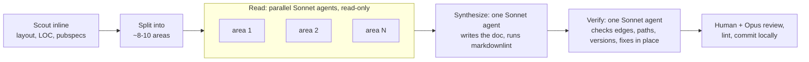

# Architecture mapping workflow

A reusable recipe for producing an architecture-and-boundaries overview of a
repository with a multi-agent Claude Code workflow. It produced
[`architecture-overview.md`](architecture-overview.md) for this repo on
2026-10-09, the baseline for the "Project Management 101" initiative. It is
written so the same run can be pointed at the backend repo and the support
repos.

## What it produces

One markdown file (`docs/internal/architecture-overview.md` by default)
containing:

- a summary and an "at a glance" table of modules and packages;
- a Mermaid dependency graph (app → feature modules → internal packages →
  key third-party deps) and a Mermaid graph of runtime and network seams;
- per-module and per-package sections: purpose, public API surface, seams,
  critical areas;
- a ranked list of critical boundaries;
- a table of third-party dependencies that need attention, with a risk
  rating;
- build, CI and platform seams;
- open questions for the project-management plan.

## Shape of the run



| Phase | Agents | Model | Writes files? |
| ----- | ------ | ----- | ------------- |
| Scout | none, the main session | session model | no |
| Read | one per area, in parallel | Sonnet | no |
| Synthesize | 1 | Sonnet | only the output doc |
| Verify | 1 | Sonnet | only the output doc |
| Review and commit | none, the main session | session model | commit |

The main session's model (Opus) does the scouting and the final review only.
The readers and writers run on Sonnet: that is faster, and it keeps file dumps
out of the main session's context, which only sees the finished document.

## Step by step

1. **Branch.** `git checkout -b meat/project-management` (or the repo's
   equivalent). Nothing is pushed until the doc has been reviewed.
2. **Scout inline** to find out how to split the work:
   - top-level layout and the module or package directories;
   - LOC per directory, so that a very large module (here `room`, about 24k
     lines) is split across two readers, by concern (execution versus UI)
     rather than by folder;
   - dependency manifests (`pubspec.yaml`, `pyproject.toml`, `package.json`);
   - the markdown lint config, because the synthesizer has to satisfy it.
3. **Define the areas.** Use 8 to 10 areas, each a scope (paths) plus a
   focus. Always include one area for third-party deps plus build, CI and
   deploy, with its own output headings (a dependency table with risk
   ratings).
4. **Run the workflow** using the script below, with the areas passed in
   `args`.
5. **Review.** Read the document, check the Mermaid diagrams render (GitHub
   preview or <https://mermaid.live>), run the linter, and commit locally.

## Reader contract

Every reader gets the same preamble, which keeps the notes uniform enough to
merge:

- read-only, and only claim what was seen in code;
- fixed headings: *Purpose*, *Public API surface*, *Dependencies* (exact,
  grep the imports), *Seams & boundaries* (network, process, isolate,
  platform channel, storage, routing, DI, cross-module contracts,
  conditional imports), *Critical / delicate areas*, *Size & test notes*;
- a cap of about 700 words.

The verify stage exists because readers summarise, and summaries drift. It
re-checks each Mermaid edge against the real imports, checks that cited paths
exist and that versions match the manifests, and checks the Mermaid syntax
(unquoted parentheses in labels are the usual breakage).

## Reusable script

Pass it to the `Workflow` tool with `args`:

```json
{
  "root": "/abs/path/to/repo",
  "repo": "soliplex (backend)",
  "asOf": "2026-10-09, main @ <sha>",
  "out": "docs/internal/architecture-overview.md",
  "lint": "npx markdownlint-cli2",
  "areas": [
    { "key": "api", "prompt": "Scope: src/soliplex/views/** — HTTP routes, auth deps, ..." },
    { "key": "deps-platform", "prompt": "Scope: third-party deps and build/CI. ..." }
  ]
}
```

```js
export const meta = {
  name: 'architecture-map',
  description: 'Map modules, API surfaces, seams and risky deps of a repo into one markdown doc',
  phases: [
    { title: 'Read', model: 'sonnet' },
    { title: 'Synthesize', model: 'sonnet' },
    { title: 'Verify', model: 'sonnet' },
  ],
}

const { root, repo, asOf, out, lint, areas } = args
const OUT = `${root}/${out}`
const COMMON = `You are mapping the architecture of ${repo} at ${root} (read-only; do NOT edit files).
Report dense markdown notes, no preamble, under these headings:
## Purpose ## Public API surface ## Dependencies (exact; grep imports; internal + third-party)
## Seams & boundaries ## Critical / delicate areas (cite file:line) ## Size & test notes
Only claim what you saw in code. Under ~700 words.`

phase('Read')
const notes = (await parallel(areas.map(a => () =>
  agent(`${COMMON}\n\n${a.prompt}`, { label: `read:${a.key}`, phase: 'Read', model: 'sonnet' })
    .then(text => ({ key: a.key, text }))))).filter(Boolean)
log(`${notes.length}/${areas.length} readers returned`)

phase('Synthesize')
const bundle = notes.map(n => `\n\n===== NOTES: ${n.key} =====\n${n.text}`).join('')
await agent(`Write ${OUT} (the ONLY file you may write; create dirs). Technical, concise, ~350-500 lines.
Sections: title + summary ("as of ${asOf}"); at-a-glance table; Mermaid dependency flowchart
(layers as subgraphs, accurate edges only); Mermaid runtime/network seams diagram; optional
sequenceDiagram of the most critical path; per-module and per-package sections; ranked
"Critical boundaries"; "Third-party dependencies needing attention" table; "Build, CI &
platform seams"; "Open questions for the PM plan". Follow the repo's markdownlint config;
run \`cd ${root} && ${lint} ${out}\` until clean. Quote Mermaid labels with special chars.
Return a 5-line summary.${bundle}`, { label: 'synthesize', phase: 'Synthesize', model: 'sonnet' })

phase('Verify')
const verdict = await agent(`Fact-check ${OUT} against the code in ${root}: every Mermaid edge
(grep imports; flag important missing edges), cited paths exist, versions match manifests,
named classes/endpoints exist, Mermaid syntax valid. Fix in place (only that file), then run
\`cd ${root} && ${lint} ${out}\` until clean. Return corrections made and unverifiable claims.`,
  { label: 'verify', phase: 'Verify', model: 'sonnet' })

return { readers: notes.map(n => n.key), verdict }
```

## Areas used for this repo

| Key | Scope |
| --- | ----- |
| `shell` | `lib/main*.dart`, the library barrel, `lib/src/{core,flavors,interfaces,shared,status_message}` |
| `auth` | `lib/src/modules/auth`, `packages/soliplex_client_native` |
| `room-exec` | `lib/src/modules/room`, the non-visual parts: run, send/cancel, upload, filters |
| `room-ui` | `lib/src/modules/room`, the visual parts: markdown, LaTeX, highlighting, citations UI |
| `features` | `lobby`, `quiz`, `versions`, `diagnostics` modules |
| `agent` | `packages/soliplex_agent` |
| `client` | `packages/soliplex_client`: endpoints, AG-UI, schema drift |
| `design-logging` | `packages/soliplex_design`, `packages/soliplex_logging`, ADR-002/003 |
| `deps-platform` | all pubspecs, the lockfile, CI, Docker, nginx, platform folders |

## Adapting it to another repo

- **Python backend.** Replace `pubspec.yaml` with `pyproject.toml` and the
  lockfile. Split readers by router or view, storage and DB layer, agent and
  tool runtime, and config. Use an `api-surface` reader that lists every
  route, and a `deps-platform` reader.
- **Small support repo** (one package, under ~5k LOC). Three or four readers
  are enough. You can drop the verify stage only if a human checks every
  diagram edge.
- **Lint.** Set `lint` to whatever the repo enforces (on this box
  `markdownlint-cli2` is only reachable through `npx`), and tell the
  synthesizer which rules are disabled.
- **Cost.** About 11 agents per run (9 readers, 1 synthesizer,
  1 verifier). Readers are independent, so wall-clock time is roughly the
  slowest reader plus two sequential agents.

## Outcome of the first run (2026-10-09)

- 11 Sonnet agents (9 readers, 1 synthesizer, 1 verifier), all succeeded.
  The run took about 5 minutes and used about 750k subagent tokens. The
  output is a 425-line overview with three Mermaid diagrams.
- The verify stage earned its keep. It found:
  - a reversed edge (`diagnostics → room` should have been `room →
    diagnostics`);
  - about eight missing edges;
  - two class names that do not exist (`OidcDiscovery`,
    `ClassificationBadge`);
  - wrong paths for the room screens (`ui/` prefix missing);
  - a false "no tests" claim about secure storage.
- Agents could not render Mermaid, so the review step rendered every block
  with
  `npx --yes -p @mermaid-js/mermaid-cli mmdc -i x.mmd -o x.svg`. All blocks
  passed. Add this to the verify prompt next time.
- `markdownlint-cli2` was not on `PATH`, so the agents fell back to `npx`.
  Pass `lint: "npx markdownlint-cli2"` up front.

## Caveats

- The output is a snapshot. Stamp it with the commit SHA and re-run it rather
  than hand-patching it once it has drifted.
- Readers can over-generalise from one file. Treat risk ratings as prompts
  for discussion, not verdicts.
- Keep the readers read-only. Only the synthesize and verify agents write,
  and only to the output file, so the run never touches source.
