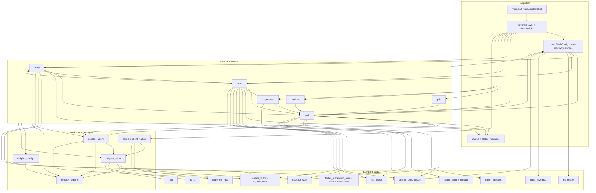
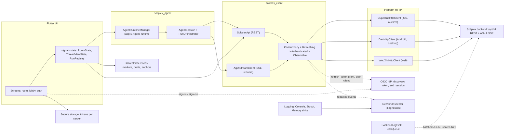
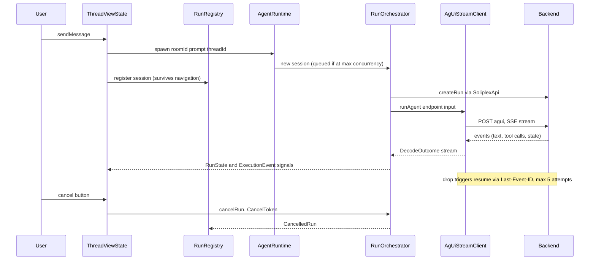

# Soliplex Frontend Architecture Overview

As of 2026-10-09, `main` @ `67b846e3`. Soliplex Frontend is a Flutter application and importable library (`lib/soliplex_frontend.dart`) for the Soliplex RAG/agent backend. A `Flavor` declares identity, theme and a list of `AppModule`s; `Flavor.build()` lowers it to a `ShellConfig` that `runSoliplexShell` boots. Six feature modules (auth, lobby, room, quiz, diagnostics, versions) contribute routes, Riverpod overrides and redirects. They sit on five workspace packages (agent, client, client_native, design, logging). Riverpod is DI only; all reactive state is `signals`. The backend link is REST plus an AG-UI SSE stream. This document is the factual base for the "Project Management 101" plan. It was compiled from per-subsystem reads; items marked "not verified" were not confirmed in code.

## At a glance

| Unit | Layer | Purpose | Approx LOC | Criticality |
| --- | --- | --- | --- | --- |
| `lib/src/core`, `flavors`, `shared`, `status_message` | Shell | Module system, router, redirects, inactivity, storage migration, flavor assembly | ~4.4k | High |
| `lib/src/mockups` | Shell (dev) | UI mockup harness (`main_mockups.dart`), excluded from coverage | ~7.2k | Low |
| `modules/auth` | Feature | Multi-server OIDC, token refresh, secure storage, guards | ~5.2k | Critical |
| `modules/lobby` | Feature | Server and room discovery, read markers | ~3.8k | Medium |
| `modules/room` | Feature | Chat, threads, uploads, citations, execution timeline | ~23.9k | Critical |
| `modules/quiz` | Feature | Room quizzes | ~1.3k | Low |
| `modules/diagnostics` | Feature | HTTP/SSE inspector, log viewer, report export | ~4.0k | Medium (security) |
| `modules/versions` | Feature | App and backend version display | ~0.6k | Low |
| `soliplex_agent` | Package (pure Dart) | Agent runtime, run orchestration, tool registry | ~6.1k | Critical |
| `soliplex_client` | Package (pure Dart) | REST and AG-UI SSE client, domain models, HTTP decorators | ~15k | Critical |
| `soliplex_client_native` | Package | Per-platform `SoliplexHttpClient` | ~0.75k | High |
| `soliplex_design` | Package | Tokens, themes, branded components | ~3.9k | Medium |
| `soliplex_logging` | Package (pure Dart) | Loggers, sinks, `describeFailure` redaction | ~2.1k | High |
| `design_system/` | Reference bundle | HTML specimen and `tokens.{css,dart,jsx}`; must stay in sync with `soliplex_design` | n/a | Low |

## Module and package dependency graph

Edges come from reported imports. `room` and `lobby` import each other's storage and marker types, and `core` reaches back into feature modules, so layering is not strict.

Notes on the graph:

- The app imports `soliplex_agent` widely (75 files, via the barrel; `versions` does not). `soliplex_agent` re-exports most of `soliplex_client`, minus the transport classes (`HttpTransport`, `SoliplexApi`, `DartHttpClient` and similar). The app builds the HTTP stack through `createAgentHttpClient`.
- `soliplex_design` is consumed only by the root app (about 115 files). `soliplex_client` and `soliplex_agent` do not depend on it.
- `FEATURES --> DESIGN`, `CLIENT`, `LOG` and `CORE` are collapsed edges covering all six modules. `SHARED` stands for `shared/` plus `status_message/`. `ROOM --> DIAG` is one file (the room module imports a diagnostics type); `diagnostics` does not import `room`.
- Edges `CORE --> AUTH/LOBBY/ROOM` and `AUTH --> CORE` are real: `core/` imports auth, lobby and room storage types, and every module imports `core/` (routes, `AppModule`, `keyed_storage`).

## Runtime and network seams

Notes:

- The decorator order in code is documented as `Concurrency -> Refreshing -> Authenticated -> Observable -> Platform` (`packages/soliplex_client/lib/src/http/refreshing_http_client.dart:23`). `TokenRefreshService` uses a separate unauthenticated client.
- `BackendLogSink` exists in `soliplex_logging`, but the shell installs no backend sink (`installLogSinks` sets up Console, Stdout and Memory only).
- On web, sign-in is a full-page BFF redirect (`/api/login/{provider}`), not AppAuth.

## Critical flow: send a message in a room

## Shell and core

Purpose: boots the app, assembles modules into one router and one `ProviderScope`, owns cross-cutting policies (inactivity, storage migration, status messages).

- Entry: `lib/main.dart` runs `installLogSinks`, `installUncaughtErrorLogging`, `CallbackParamsCapture.captureNow` plus `clearCallbackUrl`, then `runSoliplexShell(() => standard(...))`. A failing builder shows `_BootFailureApp` and rethrows.
- Public API (`lib/soliplex_frontend.dart`): `AppModule`, `ModuleRoutes` (`routes`, `overrides`, `redirect`, `publicPaths`), `Flavor`, `FlavorTheme`, `ShellConfig`, `standardFlavor`, a curated `go_router` subset, and re-exports from design and logging. `standardFlavor` is the fork customization point.
- Assembly (`core/shell_config.dart`): `fromModules` validates the theme extension, duplicate namespaces, routes and public paths, builds modules in order, and tears them all down on abort (`ShellConfigurationError`). `dispose` runs in reverse order and is the caller's job.
- Redirects: all module redirects are composed behind a public-path bypass. `publicPaths` is accepted only from the module that owns the route; without it auth's guard would block `/auth/callback`.
- Standard module order: `flavors/standard_kit.dart` lists Diagnostics, Auth, Lobby, Room, Quiz, Versions; `flavors/standard.dart` appends an optional `DocumentBrowserUrlModule`, then `extraModules(kit)`.
- Inter-module communication is by constructor-injected shared objects (`ServerManager`, `RunRegistry`, `RoomReadMarkers`, `ServerReadMarkers`, `NetworkInspector`, `AgentRuntimeManager`), not through `lib/src/interfaces/`, which holds only the 11-line sealed `AuthState`.
- Inactivity (`core/inactivity_monitor.dart`): warns after 10 minutes without pointer, scroll or key input, then logs out all active sessions after a 5-minute grace period. Setting only one duration to zero trips an assert. The logout-flag write is fire-and-forget.
- Storage: `core/storage_migration.dart` (schema v1 in `SharedPreferences`, exact-key deletes, best-effort) and `core/keyed_storage.dart` (percent-encoded composite keys, `unauthenticated` bucket). `removed_server_cleanup.dart` clears device-local state on server removal. Startup order is `clearServersIfFreshInstall`, `migrateStorage`, `restoreServers`.
- Status message: `status_message/` polls a static JSON file with a cache-buster and degrades quietly.
- Platform splits: `kIsWeb` picks `WebPlatformConstraints` or `NativePlatformConstraints`, the default backend URL (`Uri.base` on web) and the file-picker cleanup.
- Critical: `shell_config.dart` (assembly, teardown, composed redirect), `router.dart` (path validation; go_router fails silently on a top-level path without a leading slash), `shell.dart` (router built in `initState`), `standard_kit.dart` (initial route derived from callback params and auth state).
- Debt: `core/` imports `modules/auth`, `lobby` and `room`; `RemovedServerCleanup` documentation says `RoomAppModule` owns it.
- Mockups (`main_mockups.dart`, `lib/src/mockups/`): separate entry point with a static backend; `chat_screen.dart` alone is 2.8k LOC.

## Module: auth

Namespace `auth`, `lib/src/modules/auth/auth_module.dart`. Largest files: `connect_flow.dart` (437), `server_manager.dart` (368), `connection_probe.dart` (226), `auth_flow_native.dart` (208).

- Purpose: multi-server connection, OIDC sign-in and sign-out, token refresh, session persistence, home and callback screens.
- API: `AuthAppModule` (public paths `home`, `authCallback`; global redirect; `refreshListenable` over `serverManager.connectionRevision`). Providers: `serverManagerProvider`, `authFlowProvider`, `probeClientProvider`, `inactivityLogoutFlagsProvider`, `callbackParamsProvider`, `consentNoticeProvider`.
- Cross-module surface: `ServerManager.authState` (computed `AuthState`), `requireConnectedServer`, `ServerEntry`, `AuthSession.currentUserId`, `user_claims.dart`, `admin_status.dart`.
- Platform seam: `platform/auth_flow.dart` (`authenticate`, `endSession`, `AuthException` with `AuthFailureKind`, `AuthRedirectInitiated`). `auth_flow`, `callback_service` and `host_resolution` have `_native` and `_web` variants.
- Native flow: `FlutterAppAuth.authorizeAndExchangeCode` with an ephemeral web-authentication session (no shared cookie jar); `forceLoginPrompt` sends `prompt=login`; `_classifyAppAuth` maps platform errors.
- Web flow: whole-window navigation to `{backend}/api/login/{providerId}?return_to=...`, then `AuthRedirectInitiated` is thrown as control flow. The callback is captured by `callback_service_web.dart` and the URL cleared by `clearCallbackUrl`. `PreAuthState` is saved to `SharedPreferences` first and expires after `maxAge`.
- Storage: `SecureServerStorage` keeps one `soliplex_server_<id>` entry per server. Writes are serialised by `ServerManager._persistQueue`. `loadAll` skips unparseable entries.
- Token refresh: `AuthSession` implements `TokenRefresher`, shares one in-flight refresh, and moves to `ExpiredSession` on `invalid_grant`; a later refresh can revive it.
- Route guard: a route with an unconnected `serverAlias` redirects to `home?url=...&returnTo=...`; otherwise a non-authenticated state redirects to `/`.
- Sign-out: `logoutServer` fetches OIDC discovery, calls `AuthFlow.endSession`, then clears local state.
- Critical: `PreAuthState` validation, the catch sites in the sign-in and sign-out paths (see the logging rule in `CLAUDE.md`), `restoreServers` and the subscription handling in `server_manager.dart` carry security and session invariants; changes need security review.
- Imports `shared/markdown/prose_markdown` and `status_message` (not only `core`).

## Module: lobby

Namespace `lobby`, ~3.8k LOC. Route `AppRoutes.lobby` with optional `?server=`.

- API: `LobbyAppModule(ServerManager, AppIdentity, RunRegistry, RoomReadMarkers, ServerReadMarkers)`. `LobbyState` (847 LOC) holds sealed per-server states (`RoomsLoading`, `RoomsLoaded`, `RoomsFailed`, `RoomsExpired`, `RoomsSignedOut`). `RoomReadMarkers` and `ServerReadMarkers` (`lobby_read_markers.dart`, 562 LOC) are shared with room.
- Backend: `api.getRooms`, `api.getRoomsStats`, and a raw `GET {serverUrl}/api/user_info` via `entry.httpClient` (`lobby_state.dart:~769`).
- Critical: the `user_info` call bypasses `HttpTransport`, so a 401 is a response, not an `AuthException`; it is funneled manually to `entry.auth.markSessionExpired()`. Read-marker storage sweeps `SharedPreferences` by key prefix (`getKeys().where(startsWith)`), so key prefixes must stay user-scoped. `LobbyState` also clears `ThreadAnchorStorage` for vanished rooms (cross-module write).
- Depends on auth UI (`home_shell`, `server_sign_out_control`, `server_status_dot`) and room (`run_registry`, `thread_read_markers`).

## Module: room

Namespace `room`, ~23.9k LOC, the largest and most delicate module.

- API: `RoomAppModule(serverManager, runtimeManager, registry, roomReadMarkers, serverReadMarkers, appName, logo, enableDocumentFilter)`. The only Riverpod override is `messageExpansionsProvider`. Routes: `/room/:serverAlias/:roomId`, `.../thread/:threadId`, `.../info`, all guarded by `requireConnectedServer`.
- Runtime wiring: `agent_runtime_manager.dart` caches one `AgentRuntime` per server and replaces it when the `ServerConnection` changes. `run_registry.dart` (`RunRegistry`, keyed by `ThreadKey`) keeps sessions alive across navigation. `session_spawner.dart` owns the spawn state machine.
- State containers (signals): `RoomState`, `ThreadViewState` (698), `ThreadListState`, `UploadTracker` (890), `WorkdirController`, `ExecutionTracker` (481), `AnchorTracker`, `ThreadReadTracker`.
- Agent extensions: `HumanApprovalExtension` (a `ToolApprovalExtension`; pending approval is auto-denied on cancel or dispose), `execution_tracker_extension.dart`, `tool_calls_extension.dart`.
- Backend calls through `serverEntry.connection.api`: rooms, threads, documents, uploads (streamed with progress), workdir files, feedback, chunk lookup. A second raw `/api/user_info` fetch sits at `ui/room_screen.dart:~880` (TODO at 865: duplicates lobby's `_fetchUserProfile`).
- Platform seams: `pick_file.dart` and `pick_image.dart` use `dart.library.js_interop` conditional imports. On web the file blob goes straight to the browser's multipart encoder (`WebMultipartFileBody`), avoiding JS-heap buffering. Storage is `SharedPreferences` only (anchors, read markers, composer draft that survives auth-expiry redirects).
- Rendering pipeline (~950 LOC): `shared/markdown/*` plus `ui/markdown/`. `FlutterMarkdownPlusRenderer` uses the GFM extension set with builders for inline code, code blocks (`flutter_highlight`; `svg` goes to `SvgPicture.string`) and LaTeX. The inline LaTeX syntax is local (`latex_inline_syntax.dart`, four delimiter pairs, single-line bodies) replacing the package's own; it depends on the package's `latex` element name and `MathStyle` attribute. Latest commit `67b846e3` fixed spaced brackets in prose being parsed as math. Images are rendered per URI scheme in `_buildImage`.
- Layout: `isWide = maxWidth >= SoliplexBreakpoints.tablet` in `room_screen.dart`; below it the thread panel is a `Drawer`. `MessageTimeline` uses a custom `AnchoredScrollController` with a two-jump workaround for an extra layout pass.
- Critical:
  - Send/cancel lifecycle (`docs/send-cancel-lifecycle.md`): only the cancel button cancels; navigation only stops observing. `_sessionState` is simultaneously concurrency guard, UI signal and error-suppression flag. The registry-before-dispose ordering differs between `sendMessage` and `sendToNewThread`. `SessionSpawner.cancel` deliberately skips `onStateTransition`.
  - `run_registry.dart` auto-files `thumbsDown` feedback for failed runs (once, best-effort).
  - `user_switch_teardown.dart` (security): detects a user change via `AuthSession.currentUserId` and evicts runtime, runs, uploads, filters and `AdminStatus`.
  - Giant files: `ui/room_screen.dart` 2857, `upload_tracker.dart` 890, `ui/room_info_screen.dart` 875, `ui/workdir_files_section.dart` 873, `ui/chat_input.dart` 774, `ui/citations_section.dart` 762.
  - Rendering of model output (markdown, images, SVG, LaTeX, links) is security-sensitive. Security specifics are tracked privately until fixed; ask the maintainers.

## Module: quiz

Namespace `quiz`, ~1.3k LOC. `QuizAppModule(serverManager)`; route `/room/:serverAlias/:roomId/quiz/:quizId` (`?from=` return route), guarded by `requireConnectedServer`.

- Logic: `QuizSession`, `QuizSessionController` (async submit state machine). Backend: `api.getQuiz`, `api.submitQuizAnswer`. No storage or platform channels.
- Watch: the page builder returns `SizedBox.shrink()` when the server entry is missing, so the redirect is the only guard. The route shares the `/room/` path prefix with the room module.

## Module: diagnostics

Namespace `diagnostics`, ~4.0k LOC. Route `AppRoutes.diagnostics` (`?run=`), in `publicPaths`.

- API: `DiagnosticsAppModule(appName, inspector, logo?)`; `networkInspectorProvider`; `NetworkInspector` (a `ChangeNotifier` implementing `HttpObserver` and `ConcurrencyObserver`, bounded `ListQueue`s of 1000 events); `capturedLogSink(LogManager)`; `buildDiagnosticsReport`.
- No backend calls of its own. It observes traffic from `ObservableHttpClient` after `HttpRedactor`.
- Risks (`docs/diagnostics-known-risks.md`):
  - Exposure and redaction: see `docs/diagnostics-known-risks.md`.
  - `buildDiagnosticsReport` runs on the UI thread (up to 1000 exchanges and 2000 log records) and has not been measured. Isolates are not usable on web.
  - `Future.timeout` on save does not cancel the picker; the web export path has never been executed (compile-time `kIsWeb`).
  - `groupHttpEvents` silently drops orphan exchanges; `capturedLogSink` silently picks the first `MemorySink`.

## Module: versions

Namespace `versions`, ~0.6k LOC. `VersionsAppModule(appName, serverManager, logo?, versionLoader?, versionFetcher?)`. Routes `/versions` (public) and `/versions/server/:serverAlias` (guarded; unknown alias redirects in a post-frame callback). Uses `PackageInfo.fromPlatform()` and `getBackendVersionInfo()`. Low risk; injectable typedefs make it easy to test.

## Package: soliplex_agent

Pure Dart (no Flutter, `dart:io` or `dart:isolate`), ~6.1k LOC, barrel `packages/soliplex_agent/lib/soliplex_agent.dart`.

- Re-exports `signals_core`, most of `soliplex_client`, and `LogManager`/`Logger`.
- Runtime (`src/runtime/`): `AgentRuntime` (516 LOC; `spawn`, `sessions` signal, spawn queue bounded by `PlatformConstraints.maxConcurrentSessions`), `AgentSession` (828), `MultiServerRuntime`, `ServerRegistry`, `ServerConnection`, `SessionExtension` points, `ThreadState`.
- Orchestration (`src/orchestration/`): `RunOrchestrator` (1463 LOC, not exported by name), sealed `RunState` (6 variants) and `ExecutionEvent` (17 variants), LLM provider abstraction (`AgUiLlmProvider` and others).
- Other: `ToolRegistry`, host APIs (`AgentApi`, `HostApi`, `BlackboardApi`, `FormApi`), `createAgentHttpClient`, `discoverAuthProviders`, `discoverServerInfo`, `PlatformConstraints` (native, mobile, web).
- Dependencies: `soliplex_client`, `soliplex_logging`, `signals_core`, `collection`, `meta`.
- Critical:
  - `run_orchestrator.dart`: cancel races `_initializeStream`; streams opened during an await are drained if disposed meanwhile (L417-451), otherwise the SSE socket leaks; a comment at L123 names a coupling to `SoliplexApi._replayEventsToHistory` loop-index behavior.
  - `agent_session.dart` has four `deprecated_member_use` suppressions (L800-809).
  - ADR-001 (`docs/adr`): per-thread `StateBus` must be disposed via `ThreadState.dispose()`; direct `StateBus()` construction outside the runtime can leak.
  - Tool approval (`AwaitingApproval`, `ToolApprovalExtension`) gates client tool execution; implementation not reviewed.

## Package: soliplex_client

Pure Dart, ~15k LOC, `1.0.0-dev`, barrel `lib/soliplex_client.dart` (re-exports `ag_ui` with its own `CancelToken` winning).

- `SoliplexApi` (`src/api/soliplex_api.dart`, 2353 lines): rooms, threads, runs, feedback, quiz, chunk visualization, installation versions, admin check, uploads, workdir files. Free functions `fetchServerInfo`, `fetchAuthProviders`. Mappers: `mappers.dart` (775), `agui_message_mapper.dart` (516).
- Streaming: `AgUiStreamClient.runAgent(...)` returns `Stream<DecodeOutcome>`. Resume via `Last-Event-ID`: 5 attempts, 500 ms to 8 s backoff, plus or minus 20% jitter; terminal failure throws `StreamResumeFailedException`.
- HTTP: `SoliplexHttpClient` interface, `HttpTransport` (449; status to exception mapping), decorators `ConcurrencyLimitingHttpClient` (471), `RefreshingHttpClient`, `AuthenticatedHttpClient`, `ObservableHttpClient`, `SoliplexHttpAdapter` (bridges to `http.BaseClient`). `HttpRedactor` redacts headers, URIs and auth-endpoint bodies before observers see them.
- Auth: `TokenRefreshService` (sealed `TokenRefreshResult`), `OidcDiscoveryDocument` and discovery helpers in `auth/oidc_discovery.dart` (validates token and end_session endpoint origins match the discovery URL).
- Application layer: `AgUiEventProcessor` (848), `StreamingState`, `RunPhase`, `StateBus`, `JsonPatch`, `CitationExtractor` (fail-soft), `RagSnapshot` (583).
- Errors: `SoliplexException` family (`AuthException`, `NetworkException`, `ApiException`, `NotFoundException`, `CancelledException`, `MalformedResponseException`, and others).
- Backend contract: `ragStateKey='rag'` and `ragSourcesKey='sources'` must match haiku.rag's `STATE_NAMESPACE`. `test/schema/agui_feature_schema_drift_test.dart` checks a mirror against `fixtures/agui_feature_schemas/haiku-rag-0.89.0.json`; refresh with `tool/refresh_agui_feature_schemas.dart` (see `docs/refreshing-backend-schema-snapshots.md`). The test cannot see keys cleared at `begin_invocation`; that needs a manual check per refresh. Only one snapshot (0.89.0) exists.
- Uploads: native streams via `multipart_encoder.dart`; web uses the opaque `WebMultipartFileBody`, so `lib` stays free of `package:web`.
- Critical: concurrent-refresh dedupe in `RefreshingHttpClient`; slot release on queued cancel in the concurrency limiter; `SoliplexApi` is a single 2.3k-line file with heavy history-mapping logic.
- Whether `UrlBuilder`'s base URL includes `/api/v1` was not verified.

## Package: soliplex_client_native

~0.75k LOC. `createPlatformClient({defaultTimeout, onDiagnostic})` picks, via conditional import, `CupertinoHttpClient` (macOS, iOS; ephemeral `URLSessionConfiguration`, falls back to `DartHttpClient` if bindings fail), `DartHttpClient` (Android, Windows, Linux) or `WebXhrHttpClient` (XHR plus `FormData`). Single caller: `lib/src/flavors/standard_kit.dart:96`. Depends on `cupertino_http`, `http`, `web`, `meta`. Cancellation uses `CancelToken`; a cancelled streamed upload surfacing as a client error is reported as a cancellation (`cupertino_upload_cancel_teardown_test.dart` covers teardown). Tests: `api_contract`, `clients`, `platform`.

## Package: soliplex_design

Flutter leaf package, ~3.9k LOC, depends only on `flutter` and `soliplex_logging`. Barrel `soliplex_design.dart`.

- Tokens: `SoliplexSpacing`, `SoliplexBreakpoints`, radii, colors, typography, `context.monospace`, `SymbolicColors`.
- Themes: `BrandTheme` (curated; `soliplex()`, `fromSeed`, `fromAccents`) lowered by `lowerBrandTheme`; `buildSoliplexThemeData` from a full `SoliplexColors` is the explicit opt-in tier with no on-color derivation (contrast checks warn only). `FontResolver` keeps font packages out of the package.
- Components: `SoliplexButton`, `Badge`, `Chip`, `Input`, `Dropdown`, date/time pickers, `SoliplexClassificationBadge`, `SoliplexGlow`, `SoliplexShimmer`, `SoliplexShimmerText`.
- Critical: `brand_theme.dart` (700) and `theme.dart` (354) hold the lowering logic and are the likeliest place for contrast bugs (ADR-002 §4-§5). Design rules in `CLAUDE.md` are enforced by convention and review, not an analyzer lint (`design_system_hygiene_test` exists in the app tests). Goldens are a Linux baseline; never regenerate off Linux.
- `design_system/` tokens must be changed together with the package tokens.

## Package: soliplex_logging

Pure Dart, ~2.1k LOC; depends on `http` and `meta`. Exports `LogManager`, `Logger`, `LogRecord`, `LogLevel`, `LogSink`, `ConsoleSink`, `StdoutSink`, `MemorySink`, `BackendLogSink`, `DiskQueue`, `describeFailure`.

- `describeFailure` keeps a `TypeError` whole, keeps only the parameter name of `ArgumentError`/`RangeError`, keeps message and offset of `FormatException` without the source window, and reduces everything else to `runtimeType`. Nothing in the sink layer enforces its use; the "never log supplied values" rule in `CLAUDE.md` relies on every caller.
- `BackendLogSink` (582 lines, the most complex file): disk-first, held until the JWT provider returns non-null, batches capped at 900 KB with records at 64 KB, 401/403 disables export until a new JWT, a loop guard drops records mentioning its own endpoint, error records carry `MemorySink` breadcrumbs.
- `DiskQueue`: conditional import to `disk_queue_io.dart` (377 lines; merge, compaction through tmp files, crash recovery) or `disk_queue_web.dart` (57 lines, not read; persistence on web unverified).
- Tests: 14 files including `integration/backend_sink_pipeline_test.dart`.
- `packages/soliplex_tokenizers` exists on disk as an untracked directory holding only `.dart_tool`; it is not part of the workspace.

## Critical boundaries (ranked)

1. **Auth and token boundary** (`modules/auth`, `RefreshingHttpClient`, `flutter_appauth`, `flutter_secure_storage`, web BFF callback). Holds credentials; callback handling and redirect validation must stay intact; `SecureServerStorage` is tested only against a mocked plugin.
2. **User-switch and session isolation** (`user_switch_teardown.dart`, `keyed_storage`, read-marker prefix sweeps). A missed eviction exposes one user's in-memory state or stored keys to the next.
3. **Agent run lifecycle and SSE stream** (`RunOrchestrator`, `AgentSession`, `AgUiStreamClient`, `ThreadViewState`, `RunRegistry`). Cancel/dispose races, socket leaks and resume behavior concentrate here.
4. **Backend wire contract** (`ag_ui` 0.x, haiku.rag schema mirror, `SoliplexApi` mappers). Drift fails silently at runtime; protection is one schema snapshot (0.89.0) and a manual `begin_invocation` check.
5. **Logging redaction** (`describeFailure`, `MemorySink`, diagnostics screen). The rule is convention-only (see `docs/diagnostics-known-risks.md`).
6. **Shell assembly and routing** (`ShellConfig.fromModules`, composed redirect, `publicPaths`, go_router). A mistake here disables auth guarding or breaks all routes.
7. **Untrusted content rendering** (markdown, LaTeX, SVG, remote images in model output). Community forks parse backend and model content; a LaTeX bug has already shipped.
8. **Platform HTTP seam** (`soliplex_client_native`, web XHR, nginx proxy). Cancellation and upload teardown differ per platform; SSE needs unbuffered proxying.
9. **Persistent storage schema** (`storage_migration.dart`, `SharedPreferences` keys). Version 1 only; deletes must stay exact-match.

## Third-party dependencies needing attention

Versions from `pubspec.lock`.

| Package | Locked | Risk | Reason |
| --- | --- | --- | --- |
| `ag_ui` | 0.3.0 (hosted, transitive) | High | Pre-1.0 wire protocol; minor bumps can break; drift test and refresh tool exist. `docs/developer-setup.md` mentions Git LFS and `GIT_LFS_SKIP_SMUDGE`, but the lock shows pub.dev; the doc may be stale. |
| `flutter_appauth` | 12.1.0 | High | Native OIDC; per-platform redirect config; iOS/macOS error text can include the end-session URL. |
| `flutter_secure_storage` | 10.3.1 | High | Token storage; keychain entitlements on macOS; app wrapper tested against a mock only. |
| `flutter_markdown_plus_latex` (+ `flutter_math_fork` 0.7.4) | 1.0.5 | High | Fork chain parsing untrusted content; untested; local replacement syntax depends on its element contract. |
| `flutter_markdown_plus` | 1.0.12 | Medium | Community fork of a discontinued package. |
| `signals_flutter` / `signals_core` | 6.3.1 | Medium-high | Carries all app state; small ecosystem; one direct test file. |
| `go_router` | 17.5.0 | Medium | Frequent breaking majors; whole shell and guard model depends on it. |
| `flutter_riverpod` | 3.3.2 | Medium | Recent major; usage deliberately DI-only. |
| `file_picker` | 11.0.3 | Medium-high | Platform-divergent behavior; web via conditional import; iOS cancelled-save copies unverified. |
| `cupertino_http` | 2.4.0 | Medium | FFI to `NSURLSession`; Apple only. |
| `web` | 1.1.1 | Medium | Web-only paths (callback, XHR) with no tests. |
| `flutter_highlight` | 0.7.0 | Low-medium | Pre-1.0, rarely updated. |
| `markdown`, `shared_preferences`, `http`, `url_launcher`, `package_info_plus`, `flutter_svg` | various | Low | Mature; `shared_preferences` matters for key-sweep design. |

No `dependency_overrides` or git dependencies are declared.

## Build, CI and platform seams

- Toolchain: Flutter 3.41.9 pinned in `.fvmrc` (read by CI and the Dockerfile); SDK `^3.6.0`; pub workspace with `resolution: workspace`. App version `0.107.0+93`, managed by `tool/bump_version.dart` and `tool/update_version.dart`.
- `.github/workflows/flutter.yaml` triggers on push to main and PRs to main and `feat/**`, `fix/**`, `refactor/**`, `chore/**` (docs and md ignored).
  - Lint: `dart format --set-exit-if-changed`, `flutter analyze --fatal-infos`, `dart doc --dry-run`, markdownlint-cli2.
  - Test: app tests with a random seed and coverage, then per-package tests. agent, client and logging run `dart test --exclude-tags integration`; client_native and design run `flutter test` (goldens use a Linux baseline).
  - Coverage gate 80%, excluding `packages/*` and `lib/src/mockups/*`, so package code does not count toward the gate.
  - `build-web` job runs `flutter build web --release` and uploads `build/web/`. No iOS, Android or macOS build job was seen. Slack notification on failure.
- Security scanning: `gitleaks.yaml` (image `:latest`) and `trufflehog.yaml` (`@main`) run on every push, both unpinned.
- `trigger-docs-deploy.yml` dispatches `docs_update` to `soliplex/soliplex.github.io` using `DOCS_DEPLOY_TOKEN`. `update-goldens.yaml` is manual.
- Docker: multi-stage; builder on `ubuntu:focal` (end of life) builds web with `--no-tree-shake-icons`; prod is `nginx:alpine`. `nginx/nginx.conf` listens on 9000, SPA fallback, proxies `/api/` and `/mcp/` to `http://soliplex:8000` with `proxy_buffering off` and `proxy_read_timeout 120` (SSE; bounds long runs).
- Platforms:
  - Web: production path (Docker plus nginx, same-origin proxy).
  - iOS 16.0 and macOS 10.15: `cupertino_http`, URL scheme in `Info.plist`, macOS entitlements include keychain-access-groups.
  - Android: application ID `ai.soliplex.client`; the release build is signed with debug keys (TODO in `android/app/build.gradle.kts`). This is not a concern: customers build and sign the app themselves.
  - Linux and Windows: generated scaffolds only; `flutter_appauth` has no support there; treat as unsupported.
  - All platforms share identifier `ai.soliplex.client`; do not change without discussion.
- Code signing: gitignored `Local.xcconfig` (templates under `{ios,macos}/Runner/Configs`). There is no release pipeline for mobile or desktop, by design: customers build and sign their own apps.
- Lint: root `analysis_options.yaml` is `flutter_lints` only; packages use `very_good_analysis`. Design-system rules are not analyzer-enforced.

## Open questions and observations for the PM plan

- Ownership hotspots by size and risk: `room` (23.9k LOC; `room_screen.dart` 2857), `run_orchestrator.dart` (1463), `soliplex_api.dart` (2353). Candidates for splitting and for named code owners.
- Layering drift: `core/` depends on feature modules, `auth` depends on `status_message` and `shared`, and `lobby` and `room` import each other. Tracked in [#607](https://github.com/soliplex/frontend/issues/607); the proposed fix is ADR-005.
- Duplicate `/api/user_info` fetch (lobby, room, and mockups), tracked only by TODOs at `ui/room_screen.dart:865` and `mockups/chat/chat_screen.dart:826`. Both bypass `HttpTransport` error mapping.
- Convention-only rules (logging redaction, design tokens) have no CI enforcement beyond `design_system_hygiene_test`. Consider custom lints.
- Coverage gate ignores all packages, which hold the agent, client and logging code; per-package thresholds are not configured. Tracked in [#605](https://github.com/soliplex/frontend/issues/605).
- Untested or thin areas: `flutter_secure_storage` (real plugin), web code paths (`package:web`, web export in diagnostics), `cupertino_http` upload path beyond the cancel test, `AnchoredScrollController`, LaTeX package behavior, `signals` usage (one direct test file).
- Documentation drift to settle: Git LFS note in `docs/developer-setup.md` versus hosted `ag_ui`; `CLAUDE.md` lists five packages and does not mention the untracked `packages/soliplex_tokenizers` directory.
- Build coverage: CI builds web only. Release signing is out of scope because customers build the app themselves; whether CI should at least compile mobile and macOS, and whether Linux and Windows are supported, is undecided.
- Unpinned CI inputs (gitleaks `:latest`, trufflehog `@main`). End-of-life Docker base image tracked in [#606](https://github.com/soliplex/frontend/issues/606).
- Single haiku.rag schema snapshot; supporting more than one deployed backend version requires additional snapshots.
- Security posture: findings from this mapping are being handled privately with the maintainers.
- Not reviewed in this pass: `connect_flow.dart`, `connection_probe.dart`, tool-approval implementation, `rag_state_overlay.dart`, and catch-site audits for `describeFailure` in agent and client.
